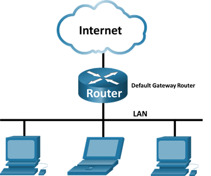
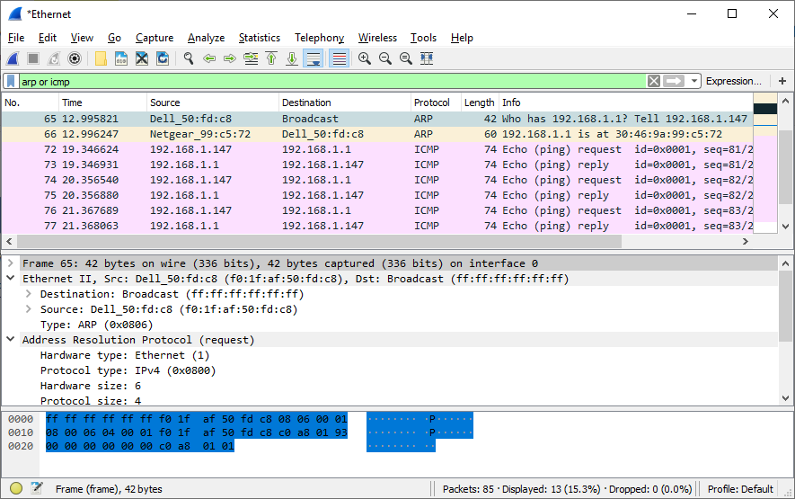
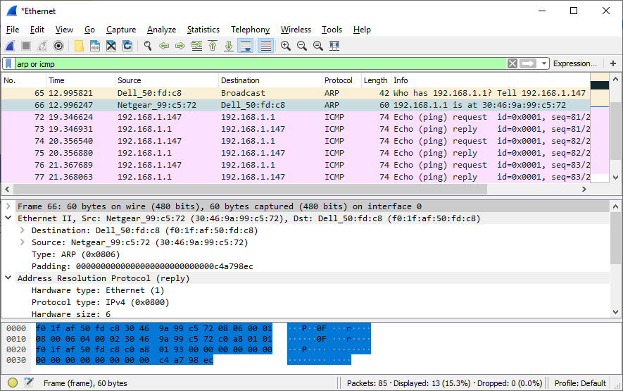
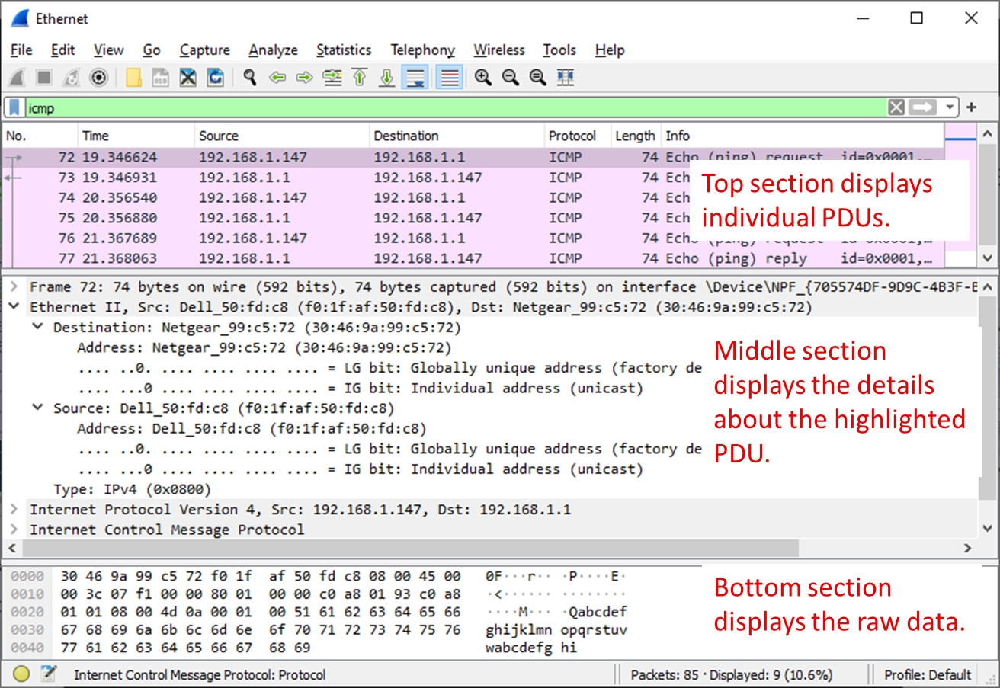
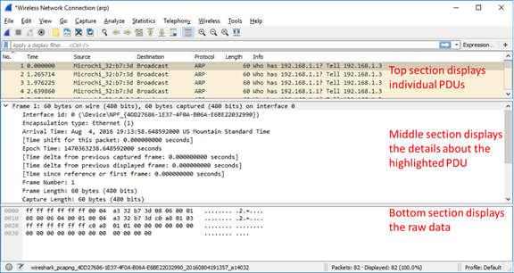
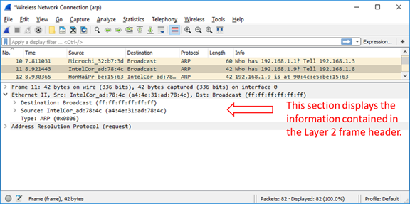
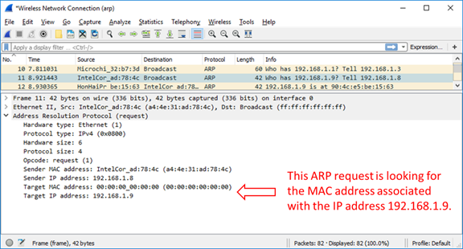

# D03-01: Ethernet рамки и ARP във Wireshark

> **Поток:** КСК | **Време:** ~90 мин | **Среда:** Windows 10/11, Wireshark 4.6.x с Npcap; Packet Tracer 8.2.2 (Част 5)
> **Задължителен минимум:** Части 1–3 и Част 4, Стъпка 1. **Разширение:** Част 2, Стъпка 7; Част 4, Стъпка 2; Част 5.
> **Връзка с курса:** лекции D01-01-02 (физически слой), D01-02 (капсулиране, PDU), D02-01 (MAC срещу IP, плоски мрежи), D02-02 (Ethernet, MAC адреси) и D01-04 (`arp`); семинар D02-01 при потока АКС + ИКТО.

---

## ПРЕДИ УПРАЖНЕНИЕТО

**За справка:** записките към лекциите [D01-01-02](../res/D01-01-02.md) (физически слой), [D01-02](../res/D01-02.md) (капсулиране, PDU), [D02-01](../res/D02-01.md) (MAC срещу IP, плоски мрежи), [D02-02](../res/D02-02.md) (Ethernet, MAC адреси, broadcast) и [D01-04](../res/D01-04.md) (командата `arp`).

**Защо ни трябва:** Рамката е PDU на каналния слой, а ARP е първата стъпка на всяка комуникация в локалната мрежа. Ако тук има грешка, нищо по-горе не работи.

**Какво трябва да видите в упражнението:** Полетата Destination, Source и Type на Ethernet рамката; ARP Request с destination `ff:ff:ff:ff:ff:ff` (broadcast) и ARP Reply, изпратен само до питащия (unicast).

### Физическият слой под рамката

Рамката, която виждате във Wireshark, е само част от предаденото по кабела. Физическият слой (L1) добавя и обработва:

- **Preamble (7 байта) и SFD (1 байт)** – редуващи се 1 и 0 за синхронизация на приемника; мрежовата карта ги премахва, затова Wireshark не ги показва;
- **кодирането** – превръщането на битовете в сигнал (например 4B/5B при 100BASE-TX);
- **средата** – мед (UTP, до 100 м), оптика (километри) или радиовълни.

FCS (4 байта) е в края на рамката и проверява дали тя е пристигнала без грешки. Ако FCS не съвпада, рамката се отхвърля още от мрежовата карта.

### Етикет 802.1Q (VLAN)

По trunk връзка между комутатори или към маршрутизатор рамката носи допълнителни **4 байта** след Source MAC: етикет 802.1Q с номера на VLAN. Тогава Type е `0x8100`. На компютъра в учебната зала етикетът обикновено не се вижда, защото портът на компютъра е access порт и комутаторът премахва етикета.

### MAC срещу IP и плоската мрежа

| | MAC адрес | IP адрес |
|---|---|---|
| Слой | L2 (канален) | L3 (мрежов) |
| Обхват | само локалната мрежа | от източника до целта, през маршрутизатори |
| Кой го използва за решения | комутаторът | маршрутизаторът |

ARP Request се изпраща като **broadcast** и се получава от **всяко** устройство в broadcast домейна. В плоска мрежа (една мрежа без VLAN и без маршрутизатори) всички устройства обработват всички ARP и DHCP broadcast съобщения. Колкото повече са устройствата, толкова повече е ненужният трафик. Затова мрежите се разделят на по-малки сегменти (VLAN, подмрежи), свързани с маршрутизатор.

### Проверете се

1. Кои части на предаденото по кабела не се виждат във Wireshark и защо?
2. Какъв е destination MAC адресът на рамка към сървър в Интернет: на сървъра или на шлюза?
3. Защо ARP Request се изпраща като broadcast, а ARP Reply – като unicast?
4. Кои устройства получават един ARP Request в мрежа с 200 компютъра без VLAN? Какво следва от това за плоските мрежи?

---

## Топология (Части 3 и 4)

<!-- TODO: заменете със снимка от Wireshark 4.6 -->


## Цели на упражнението

### Ethernet рамка

#### Част 1: Изследване на заглавните полета в Ethernet II рамка

- Преглед на описанията и дължините на полетата в Ethernet II header
- Изследване на мрежовата конфигурация на компютъра
- Изследване на Ethernet рамки в прихванат трафик
- Изследване на съдържанието на Ethernet II header в ARP request

#### Част 2: Използване на Wireshark за прихващане и анализ на Ethernet рамки

- Определяне на IP адреса на default gateway
- Стартиране на прихващане на трафик на мрежовия адаптер (NIC)
- Филтриране в Wireshark за показване само на ICMP трафик
- Ping към default gateway
- Спиране на прихващането
- Изследване на Echo (ping) request рамки
- Прихващане на пакети към отдалечен хост

### ARP

#### Част 3: Прихващане и анализ на локални ARP данни във Wireshark

- Стартиране и спиране на прихващането на данни от ping трафик до хостове в локалната мрежа
- Намиране на IPv4 и MAC адресна информация в прихванатите PDU
- Анализиране на съдържанието на ARP съобщенията, обменени между устройствата в LAN

#### Част 4: Преглед на ARP кеш записите на компютъра

- Достъп до Windows Command Prompt
- Използване на командата `arp` за преглед на локалната ARP таблица в кеша на компютъра

## Теоретична основа

### Ethernet рамка

Когато протоколите от горните слоеве комуникират помежду си, данните преминават надолу през слоевете на OSI или TCP/IP модела и се капсулират в Layer 2 рамка, когато достигнат data link слоя. Структурата на рамката зависи от типа на средата, през която данните се предават. Например рамките, които пътуват през Ethernet, се различават от рамките, които пътуват през WLAN или серийна връзка.

Ethernet II рамката е типичната структура, използвана в TCP/IP мрежите. Wireshark декодира и показва полетата на рамката от Destination MAC адреса до данните. Preamble, SFD и обикновено FCS не присъстват в прихващането, защото мрежовият адаптер ги обработва и премахва, преди да предаде рамката на операционната система.

В това упражнение ще разгледате заглавните полета и съдържанието на Ethernet II рамка. Ще използвате Wireshark за прихващане и изследване на Ethernet II рамки към локални и отдалечени хостове.

### ARP

**Address Resolution Protocol (ARP)** се използва от TCP/IP за напасване (map, mapping) на IPv4 адрес от слой 3 към MAC адрес от слой 2. Когато Ethernet frame се изпраща в мрежата, той трябва да има destination MAC адрес. За да открие динамично MAC адреса на известна дестинация, source устройството излъчва (broadcast) ARP request в локалната мрежа. Устройството, което притежава IP адреса, отговаря с ARP reply съобщение (unicast), което съдържа неговия MAC адрес.

Всяко устройство в локалната мрежа поддържа собствен ARP кеш. ARP кешът е малка област в RAM паметта, която съхранява ARP отговорите. Преглеждането на ARP кеша на компютър показва IPv4 адреса и MAC адреса на всяко устройство в локалната мрежа, с което компютърът е обменил ARP съобщения.

**Wireshark** е софтуерен protocol analyzer (пакетен анализатор), или "packet sniffer" приложение, използвано за прихващане (capture) и преглед на данни, пътуващи през мрежата.

Wireshark **декодира пакета до нивото на полетата (fields) в рамката**. Това означава, че той не само прихваща суровите байтове, но и ги разбива на отделните им компоненти. Например при ARP рамка Wireshark показва поотделно MAC адресите (source и destination), типа на протокола, IP адресите и типа на операцията (request/reply).

Wireshark вижда трафика, който достига до мрежовия адаптер на компютъра. В комутирана мрежа това са собственият трафик на компютъра и broadcast/multicast рамките. За да се наблюдава чужд unicast трафик, комутаторът трябва предварително да е настроен да копира трафика към порта на компютъра (port mirroring, SPAN). Самото стартиране на Wireshark не включва тази функция.

Когато данните се изпращат от един хост към друг в мрежата, пакетът е капсулиран с информация за заглавката (header), която включва source и destination MAC адреси. MAC адресът на destination хоста се открива чрез ARP процеса. Чрез изследване на ARP съобщенията в Wireshark можете да наблюдавате този процес и да идентифицирате IP и MAC адресите на хостовете, комуникиращи в локалната мрежа.

## Необходими ресурси

- 1 PC (Windows 10/11) с Wireshark 4.6.x и Npcap и с достъп до Интернет
- Права за стартиране на Command Prompt като администратор (за `arp -d`)
- Допълнителни компютри в локалната мрежа (LAN), които ще отговарят на ping заявки. Ако няма такива, за отговор на ping заявките се използва default gateway.

> **Важно за филтрите:** Wireshark има два вида филтри. **Capture filter** (на началния екран, преди старта) решава кои пакети изобщо да се запишат и използва друг синтаксис. **Display filter** (лентата над списъка с пакети) само скрива пакети от екрана. В това упражнение стартирайте прихващането **без** capture filter и въвеждайте филтрите (`arp`, `icmp`, `arp or icmp`) в лентата за display filter.

---

## Част 1: Изследване на заглавните полета в Ethernet II рамка

В Част 1 ще изследвате заглавните полета и съдържанието на Ethernet II рамка, като използвате готово прихващане.

### Стъпка 1: Преглед на описанията и дължините на полетата в Ethernet II header

Ethernet II рамката се състои от следните полета:

| Поле | Дължина | Описание |
|------|---------|----------|
| Preamble | 7 байта | Използва се за синхронизация между изпращащото и получаващото устройство |
| Start Frame Delimiter (SFD) | 1 байт | Сигнализира началото на рамката |
| Destination MAC Address | 6 байта | MAC адресът на устройството получател |
| Source MAC Address | 6 байта | MAC адресът на устройството изпращач |
| Type / Length | 2 байта | Стойност ≥ 0x0600 е **Type** и идентифицира протокола в полето Data (0x0800 = IPv4, 0x0806 = ARP, 0x86DD = IPv6). Стойност ≤ 1500 е **Length** (рамка IEEE 802.3) |
| Data | 46–1500 байта | Съдържа данните (Layer 3 PDU); при по-малко от 46 байта се допълва (padding) |
| Frame Check Sequence (FCS) | 4 байта | Използва се за откриване на грешки в рамката |

> **Забележка:** Wireshark не показва Preamble и SFD, защото тези полета се обработват на хардуерно ниво от мрежовия адаптер. По същата причина в прихващане под Windows обикновено липсва и FCS: адаптерът я проверява и премахва.

### Стъпка 2: Изследване на мрежовата конфигурация на компютъра

В този пример компютърът има IP адрес 192.168.1.147 и default gateway с IP адрес 192.168.1.1. (За Linux използвайте `ip addr`, а за macOS – `ifconfig` в терминала.)

```
C:\>ipconfig /all

Ethernet adapter Ethernet:

   Connection-specific DNS Suffix  . :
   Description . . . . . . . . . . . : Intel(R) 82579LM Gigabit Network Connection
   Physical Address. . . . . . . . . : F0-1F-AF-50-FD-C8
   DHCP Enabled. . . . . . . . . . . : Yes
   Autoconfiguration Enabled . . . . : Yes
   Link-local IPv6 Address . . . . . : fe80::58c5:45f2:7e5e:29c2%11(Preferred)
   IPv4 Address. . . . . . . . . . . : 192.168.1.147(Preferred)
   Subnet Mask . . . . . . . . . . . : 255.255.255.0
   Default Gateway . . . . . . . . . : 192.168.1.1
   DHCP Server . . . . . . . . . . . : 192.168.1.1
   <output omitted>
```

### Стъпка 3: Изследване на Ethernet рамки в прихванат трафик

Следващите снимки показват пакетите, генерирани от ping, изпратен от компютъра до неговия default gateway. Приложен е display filter `arp or icmp`, за да се виждат само ARP и ICMP. ARP (Address Resolution Protocol) се използва за определяне на MAC адреса, свързан с даден IP адрес. Сесията започва с ARP request и reply за MAC адреса на шлюза, последвани от четири ping requests и replies.

<!-- TODO: заменете със снимка от Wireshark 4.6 -->


Тази снимка подчертава детайлите на рамката за ARP request.

<!-- TODO: заменете със снимка от Wireshark 4.6 -->


Тази снимка подчертава детайлите на рамката за ARP reply.

### Стъпка 4: Изследване на съдържанието на Ethernet II header в ARP request

Следващата таблица взема първата рамка в прихващането и показва данните в полетата на Ethernet II header:

| Поле | Стойност |
|------|----------|
| Destination MAC Address | ff:ff:ff:ff:ff:ff (Broadcast) |
| Source MAC Address | f0:1f:af:50:fd:c8 (Wireshark го показва като Dell_50:fd:c8) |
| Type | 0x0806 (ARP) |

#### Въпроси:

**1.** Какво е значимо в съдържанието на полето destination address?

**2.** Защо компютърът изпраща broadcast ARP преди първия ping request?

**3.** Какъв е source MAC адресът в първата рамка?

**4.** Какъв е Vendor ID (OUI) на source NIC в ARP request?

**5.** Коя част от MAC адреса е OUI?

**6.** Каква е частта от MAC адреса, присвоена от производителя на конкретния адаптер?

<details markdown="1">
<summary>Отговори за самопроверка</summary>

1. Destination адресът е `ff:ff:ff:ff:ff:ff`, т.е. broadcast. ARP request се изпраща до всички устройства в локалната мрежа.
2. Компютърът трябва да научи MAC адреса на default gateway, за да изпрати ping пакета. Тъй като първоначално не го знае, той пита с broadcast: „Кой има IP адрес 192.168.1.1?“.
3. `F0:1F:AF:50:FD:C8` – MAC адресът на мрежовия адаптер на компютъра.
4. OUI е `F0:1F:AF`. Той е регистриран на **Dell**. Затова Wireshark показва адреса като `Dell_50:fd:c8`. Описанието „Intel 82579LM“ в `ipconfig` е моделът на чипа, а адресът е присвоен от производителя на компютъра.
5. Първите 3 октета (байта) на MAC адреса.
6. Последните 3 октета, `50:FD:C8`. Това е идентификатор на конкретния адаптер, присвоен от производителя (NIC-specific part).

</details>

---

## Част 2: Използване на Wireshark за прихващане и анализ на Ethernet рамки

В Част 2 ще използвате Wireshark за прихващане на локални и отдалечени Ethernet рамки. След това ще изследвате информацията в заглавните полета на рамката.

### Стъпка 1: Определяне на IP адреса на default gateway на вашия компютър

**a.** Отворете Windows Command Prompt.

**b.** Въведете командата `ipconfig`. (За Linux използвайте `ip route`, а за macOS – `netstat -rn`.)

**c.** Запишете IP адреса на default gateway на компютъра.

```
C:\>ipconfig

Ethernet adapter Ethernet:

   Connection-specific DNS Suffix  . :
   Link-local IPv6 Address . . . . . : fe80::58c5:45f2:7e5e:29c2%11
   IPv4 Address. . . . . . . . . . . : 192.168.1.147
   Subnet Mask . . . . . . . . . . . : 255.255.255.0
   Default Gateway . . . . . . . . . : 192.168.1.1
```

_Какъв е IP адресът на default gateway на вашия компютър?_

**d.** Затворете прозореца на Command Prompt.

### Стъпка 2: Стартиране на прихващане на трафик на NIC на компютъра

**a.** Отворете Wireshark. Оставете полето за capture filter празно и кликнете двукратно на интерфейса с мрежов трафик, за да стартирате прихващането.

**b.** Наблюдавайте трафика, който се появява в списъка с пакети.

### Стъпка 3: Филтриране в Wireshark за показване само на ICMP трафик

Display filter не спира записването на нежелани данни; той само определя какво се показва на екрана. За сега ще се показва само ICMP трафик.

В лентата за display filter напишете `icmp`. Полето трябва да стане зелено, ако филтърът е въведен правилно. Натиснете Enter или кликнете стрелката вдясно на лентата, за да приложите филтъра.

### Стъпка 4: Ping към default gateway на вашия компютър

**a.** Отворете Windows Command Prompt.

**b.** Направете ping на default gateway, използвайки IP адреса, който записахте в Стъпка 1.

```
C:\>ping 192.168.1.1

Pinging 192.168.1.1 with 32 bytes of data:
Reply from 192.168.1.1: bytes=32 time<1ms TTL=64
Reply from 192.168.1.1: bytes=32 time<1ms TTL=64
Reply from 192.168.1.1: bytes=32 time<1ms TTL=64
Reply from 192.168.1.1: bytes=32 time<1ms TTL=64

Ping statistics for 192.168.1.1:
    Packets: Sent = 4, Received = 4, Lost = 0 (0% loss),
Approximate round trip times in milli-seconds:
    Minimum = 0ms, Maximum = 0ms, Average = 0ms
```

**c.** Затворете прозореца на Command Prompt.

### Стъпка 5: Спиране на прихващането на трафик

Кликнете иконата **Stop capturing packets** (червения квадрат), за да спрете прихващането.

### Стъпка 6: Изследване на първия Echo (ping) request във Wireshark

Главният прозорец на Wireshark е разделен на три секции: **Packet List** (горе), **Packet Details** (в средата) и **Packet Bytes** (долу). Ако сте избрали правилния интерфейс, Wireshark показва ICMP пакетите в Packet List.

<!-- TODO: заменете със снимка от Wireshark 4.6 -->


**a.** В Packet List кликнете на първата рамка в списъка. В колоната Info трябва да видите **Echo (ping) request**. Редът трябва да бъде подсветен.

**b.** Изследвайте първия ред в Packet Details. Този ред показва дължината на рамката.

_Каква е дължината на рамката?_

**c.** Вторият ред в Packet Details показва, че това е Ethernet II рамка. Показани са и source и destination MAC адресите.

_Какъв е MAC адресът на NIC на компютъра?_

_Какъв е MAC адресът на default gateway?_

**d.** Кликнете стрелката (>) в началото на втория ред, за да видите повече информация за Ethernet II рамката.

_Каква е стойността на полето Type и какъв протокол означава?_

**e.** Последните два реда в средната секция съдържат информация за полето Data на рамката: заглавките на IPv4 и ICMP. Забележете, че данните съдържат source и destination IPv4 адресите.

_Какъв е source IP адресът?_

_Какъв е destination IP адресът?_

**f.** Можете да кликнете на всеки ред в средната секция, за да подсветите съответната част от рамката (hex и ASCII) в Packet Bytes. Кликнете на реда **Internet Control Message Protocol** и изследвайте какво е подсветено.

_Какво изписват последните два подсветени октета?_

**g.** Кликнете на следващата рамка в горната секция и изследвайте Echo reply рамката. Забележете, че source и destination MAC адресите са разменени, тъй като тази рамка е изпратена от default gateway като отговор на първия ping.

_Кое устройство и кой MAC адрес се показват като destination адрес?_

<details markdown="1">
<summary>Отговори за самопроверка</summary>

- **d.** Type е `0x0800`, т.е. IPv4.
- **f.** При Windows данните на ping са `abcdefghijklmnopqrstuvwabcdefghi` (32 байта), затова последните два октета изписват **hi**.
- **g.** Destination е вашият компютър и неговият MAC адрес.

</details>

### Стъпка 7 (разширение): Прихващане на пакети към отдалечен хост

> **Предвидете:** Преди да изпълните стъпката, запишете кои от четирите адреса (source/destination MAC, source/destination IP) ще бъдат същите като в Стъпка 6 и кои ще се променят.

**a.** Кликнете иконата **Start capturing packets**, за да стартирате ново прихващане. Ще се появи прозорец с въпрос дали да запазите предишните пакети във файл. Кликнете **Continue without Saving**.

**b.** В Command Prompt направете ping на www.cisco.com. Адресът, който ще получите, може да е различен от примера.

```
C:\>ping www.cisco.com

Pinging e144.dscb.akamaiedge.net [23.222.28.109] with 32 bytes of data:
Reply from 23.222.28.109: bytes=32 time=30ms TTL=56
Reply from 23.222.28.109: bytes=32 time=29ms TTL=56
Reply from 23.222.28.109: bytes=32 time=30ms TTL=56
Reply from 23.222.28.109: bytes=32 time=29ms TTL=56

Ping statistics for 23.222.28.109:
    Packets: Sent = 4, Received = 4, Lost = 0 (0% loss),
Approximate round trip times in milli-seconds:
    Minimum = 29ms, Maximum = 30ms, Average = 29ms
```

**c.** Спрете прихващането.

**d.** Изследвайте новите данни в Packet List.

_В първата Echo (ping) request рамка какви са source и destination MAC адресите?_

- Source: ______
- Destination: ______

_Какви са source и destination IP адресите в полето Data на рамката?_

- Source: ______
- Destination: ______

Сравнете тези адреси с адресите от Стъпка 6. Единственият адрес, който се е променил, е destination IP адресът. _Защо destination IP адресът се е променил, докато destination MAC адресът е останал същият?_

<details markdown="1">
<summary>Отговор</summary>

Когато ping се изпраща към отдалечен хост (извън локалната мрежа), destination MAC адресът е MAC адресът на default gateway, защото рамката трябва първо да стигне до шлюза. Destination IP адресът е адресът на крайната дестинация (www.cisco.com). При обикновена маршрутизация IP адресите не се променят по пътя, а MAC адресите се сменят на всяка мрежа. Ако локалната мрежа използва частни адреси, маршрутизаторът на изхода към Интернет допълнително подменя **source** IP адреса чрез NAT; това не се вижда в прихващането на вашия компютър.

</details>

---

## Част 3: Прихващане и анализ на локални ARP данни във Wireshark

В Част 3 на това упражнение ще направите ping на друг компютър в LAN и ще прихванете ARP requests и replies във Wireshark. Ще разгледате и съдържанието на прихванатите рамки. Този анализ трябва да изясни как заглавките на пакетите се използват за транспорт на данните до тяхната дестинация.

### Стъпка 1: Извличане на интерфейсните адреси на вашия компютър

За това упражнение ще трябва да извлечете IPv4 адреса и MAC адреса на вашия компютър.

**a.** Отворете Command Prompt **като администратор** (Start, напишете `cmd`, десен бутон, **Run as administrator**) и въведете командата `ipconfig /all`.

**b.** Отбележете кой мрежов адаптер използва компютърът за достъп до мрежата. Запишете IPv4 адреса и MAC адреса (Physical Address) на интерфейса на вашия компютър.

```
C:\Users\Student>ipconfig /all

<output omitted>

Wireless LAN adapter Wireless Network Connection:
   Connection-specific DNS Suffix  . :
   Description . . . . . . . . . . . : Intel(R) Centrino(R) Advanced-N 6205
   Physical Address. . . . . . . . . : A4-AE-31-AD-78-4C
   DHCP Enabled. . . . . . . . . . . : Yes
   Autoconfiguration Enabled . . . . : Yes
   Link-local IPv6 Address . . . . . : fe80::f9e7:e41d:a772:f993%11(Preferred)
   IPv4 Address. . . . . . . . . . . : 192.168.1.8(Preferred)
   Subnet Mask . . . . . . . . . . . : 255.255.255.0
   Default Gateway . . . . . . . . . : 192.168.1.1
   DHCP Server . . . . . . . . . . . : 192.168.1.1
   DNS Servers . . . . . . . . . . . : 192.168.1.1
```

**c.** Попитайте колега за IPv4 адреса на неговия компютър и му дайте вашия IPv4 адрес. Не давайте вашия MAC адрес в този момент.

Запишете в Notepad IPv4 адресите на default gateway и на другите компютри в LAN.

**d.** Изчистете ARP кеша, за да сте сигурни, че ще има нов ARP обмен. Ако адресът на шлюза вече е в кеша, компютърът няма да изпрати ARP request и Wireshark няма да покаже ARP рамки.

```
C:\Windows\System32>arp -d
```

> **Забележка:** Без администраторски права Windows отказва изтриването със съобщение, че операцията изисква повишени права (elevation).

> **Предвидете:** Преди да стартирате прихващането, запишете какъв ще бъде destination MAC адресът на ARP request и какъв ще бъде destination MAC адресът на ARP reply.

### Стъпка 2: Стартиране на Wireshark и започване на прихващането на данни

**a.** На вашия компютър кликнете **Start** и напишете **Wireshark**. Стартирайте приложението.

**b.** На началния екран изберете мрежовия интерфейс, който идентифицирахте с командата `ipconfig` (обикновено **Ethernet** или **Wi-Fi**; активният интерфейс има графика на трафика до името си). Не въвеждайте нищо в полето за capture filter. Кликнете **Start capturing packets** (синята икона с перка на акула).

**c.** В лентата за display filter (**Apply a display filter**) над списъка с пакети въведете `arp` и натиснете Enter. Полето трябва да стане зелено. Сега Wireshark показва само пакетите от ARP обмена.

Всеки ред в горната секция представлява съобщение, изпратено между source и destination устройство в мрежата.

**d.** В Command Prompt направете ping на default gateway, за да тествате свързаността към адреса, идентифициран в Част 3, Стъпка 1.

```
C:\Windows\System32>ping 192.168.1.1

Pinging 192.168.1.1 with 32 bytes of data:
Reply from 192.168.1.1: bytes=32 time=7ms TTL=64
Reply from 192.168.1.1: bytes=32 time=2ms TTL=64
Reply from 192.168.1.1: bytes=32 time=1ms TTL=64
Reply from 192.168.1.1: bytes=32 time=6ms TTL=64

Ping statistics for 192.168.1.1:
    Packets: Sent = 4, Received = 4, Lost = 0 (0% loss),
Approximate round trip times in milli-seconds:
    Minimum = 1ms, Maximum = 7ms, Average = 4ms
```

**e.** Направете ping на IPv4 адресите на други компютри в LAN, които са ви дали вашите колеги.

> **Забележка:** Ако компютърът на вашия колега не отговаря на ping, това може да се дължи на firewall, който блокира тези заявки. Помолете преподавателя за помощ при необходимост.

**f.** Спрете прихващането на данни, като кликнете **Stop capturing packets** (червения квадрат) в лентата с инструменти.

### Стъпка 3: Изследване на прихванатите данни

В Стъпка 3 ще изследвате данните, генерирани от ping заявките. Wireshark показва данните в три секции:

1. **Горната секция (Packet List)** показва списъка на прихванатите рамки с резюме за всяка от тях.
2. **Средната секция (Packet Details)** показва избраната рамка, разделена по нейните протоколни слоеве.
3. **Долната секция (Packet Bytes)** показва суровите данни на рамката в шестнадесетичен (hex) вид и като ASCII символи.

**a.** Кликнете на една от ARP рамките в горната секция, която има MAC адреса на вашия компютър като source адрес и "Broadcast" като destination.

**b.** С избрана рамка преминете към средната секция. Кликнете на стрелката вляво от реда **Ethernet II**, за да видите Destination и Source MAC адресите.

_Съвпада ли Source MAC адресът с адреса на интерфейса на вашия компютър?_

<!-- TODO: заменете със снимка от Wireshark 4.6 -->


**c.** Кликнете на стрелката вляво от реда **Address Resolution Protocol (request)**, за да видите съдържанието на ARP request.

_Каква е стойността на полето Type в Ethernet II заглавката?_

### Стъпка 4: Намиране на ARP reply рамката, която съответства на маркирания ARP request

**a.** Използвайки **Target IP address** в ARP request, намерете ARP reply рамката в горната секция.

_Какъв е IPv4 адресът на Target устройството във вашия ARP request?_

**b.** Маркирайте reply рамката в горната секция. Може да се наложи да превъртите списъка. Разгънете редовете **Ethernet II** и **Address Resolution Protocol (reply)** в средната секция.

_Broadcast рамка ли е ARP reply?_

_Какъв е destination MAC адресът на рамката?_

_Съвпада ли той с MAC адреса на вашия компютър?_

_Какъв е source MAC адресът на рамката?_

<!-- TODO: заменете със снимка от Wireshark 4.6 -->


**c.** Проверете с вашия колега дали MAC адресът съвпада с MAC адреса на неговия компютър.

<details markdown="1">
<summary>Отговори за самопроверка</summary>

- Type в Ethernet II заглавката на ARP рамка е **0x0806**.
- ARP request е broadcast (`ff:ff:ff:ff:ff:ff`), а ARP reply е **unicast**: destination е MAC адресът на вашия компютър, а source е MAC адресът на устройството, притежаващо търсения IP адрес.

</details>

---

## Част 4: Изследване на ARP кеш записите на компютъра

Когато устройствата изпращат трафик в локалната мрежа, те трябва да напаснат IP адресите към MAC адреси. За да намалят броя на ARP broadcasts, компютрите кешират ARP отговорите в паметта за кратък период от време.

### Стъпка 1: Преглед на ARP кеша на вашия компютър

**a.** В Command Prompt въведете `arp -a` и натиснете Enter.

```
C:\Windows\System32>arp -a

Interface: 192.168.1.8 --- 0xb
  Internet Address      Physical Address      Type
  192.168.1.1           c0-3f-0e-b7-ce-30     dynamic
  192.168.1.11          08-3e-8e-ba-e4-f9     dynamic
  192.168.1.255         ff-ff-ff-ff-ff-ff     static
  224.0.0.22            01-00-5e-00-00-16     static
  224.0.0.251           01-00-5e-00-00-fb     static
  224.0.0.252           01-00-5e-00-00-fc     static
  239.255.255.250       01-00-5e-7f-ff-fa     static
  255.255.255.255       ff-ff-ff-ff-ff-ff     static
```

_Появяват ли се в ARP таблицата всички устройства, на които направихте ping? Ако не, защо?_

<!-- TODO: заменете със снимка от Wireshark 4.6 -->


### Стъпка 2 (разширение): Изследване на ARP процеса, когато кеш записът изчезне

**a.** Във Wireshark кликнете **Start capturing packets**, за да започнете ново прихващане. Изберете **Continue without Saving**, ако бъдете попитани. Display filter `arp` остава.

**b.** В Command Prompt (като администратор) въведете `arp -d` и натиснете Enter. Това изтрива всички записи в ARP кеша.

```
C:\Windows\System32>arp -d
```

**c.** Направете ping на default gateway или на друг компютър в мрежата.

**d.** Спрете прихващането във Wireshark. Ще видите нови ARP request и reply съобщения.

**e.** Въведете отново `arp -a`. Сега ще видите запис за устройството, на което току-що направихте ping.

---

## Част 5 (разширение): Същият ARP като PDU в Packet Tracer

Тази част свързва наблюдението във Wireshark с режима **Simulation** на Packet Tracer, който потокът АКС + ИКТО използва.

**a.** В Packet Tracer поставете комутатор **2960** и два компютъра **PC0** и **PC1**. Свържете ги с прави кабели (Copper Straight-Through).

**b.** Задайте адреси: PC0 – `192.168.1.10/24`, PC1 – `192.168.1.11/24` (**Desktop → IP Configuration**).

**c.** Превключете в **Simulation**. В **Edit Filters** оставете само **ARP** и **ICMP**.

**d.** От PC0 изпълнете `ping 192.168.1.11` (**Desktop → Command Prompt**). Натискайте **Capture/Forward**.

**e.** Кликнете върху първия ARP пакет и отворете **Outbound PDU Details**. Сравнете с прихващането от Част 3:

| Поле | Wireshark (Част 3) | Packet Tracer |
|------|--------------------|---------------|
| Destination MAC на ARP Request | | |
| Opcode (Request/Reply) | | |
| Target IP | | |

- _Кои устройства получават ARP Request в Packet Tracer и кои – ARP Reply?_ ______
- _Кое от двете средства показва повече полета и защо?_ ______

---

## Въпроси за размисъл

**1.** Wireshark не показва полето Preamble на frame header. Какво съдържа Preamble?

<details markdown="1">
<summary>Отговор</summary>

Preamble съдържа 7 байта с редуваща се последователност от единици и нули (`10101010`), която позволява на получаващото устройство да синхронизира часовника си с изпращащото. Следва SFD (`10101011`), който отбелязва началото на рамката. И двете полета се обработват на хардуерно ниво и не се виждат в софтуерни анализатори като Wireshark.

</details>

**2.** Каква е ползата от запазването на ARP кеш записите в паметта на source компютъра?

<details markdown="1">
<summary>Отговор</summary>

Запазването на ARP кеш записи намалява броя на ARP broadcast съобщенията в мрежата. Когато хост трябва да изпрати данни към друг хост, той първо проверява своя ARP кеш за съответстващ MAC адрес и чак тогава изпраща ARP request. Това ускорява комуникацията и намалява мрежовия трафик.

</details>

**3.** Ако destination IPv4 адресът не е в същата мрежа като source хоста, какъв MAC адрес ще се използва като destination MAC адрес в рамката?

<details markdown="1">
<summary>Отговор</summary>

Ако destination IPv4 адресът е в друга мрежа, source хостът използва MAC адреса на default gateway (маршрутизатора) като destination MAC адрес в Ethernet рамката. Затова в ARP request той търси IP адреса на шлюза, а не IP адреса на крайната дестинация. Маршрутизаторът препраща пакета към правилната мрежа.

</details>

---

## Обяснете сами (без готов отговор)

1. Защо в Echo reply source и destination MAC адресите са разменени спрямо Echo request?
2. Как Wireshark „знае“, че в полето Data на рамката има IPv4 пакет, а не ARP съобщение?
3. Какъв ще бъде destination MAC адресът, ако в мрежата няма default gateway и направите ping до отдалечен хост?

4. Защо преди прихващането изчистихме ARP кеша?
5. Кое поле в прихванатите рамки доказва, че ARP reply е изпратен само до вашия компютър?
6. Какво ще видите във Wireshark, ако направите ping до адрес в същата мрежа, който не е зает от никое устройство?

---

## Заключение

В това упражнение изучихме структурата на Ethernet II рамката и изследвахме полетата в нейната заглавка. Разбрахме ролята на MAC адресите в локалната комуникация и как Ethernet рамките капсулират IP пакети. Видяхме разликата между комуникация с локален хост (в същата мрежа) и с отдалечен хост (извън локалната мрежа): destination MAC адресът сочи към следващия hop (шлюза за отдалечени хостове), а destination IP адресът остава адресът на крайната дестинация.

В това упражнение използвахме Wireshark за прихващане и анализ на ARP трафик в локалната мрежа. Видяхме как ARP напасва IP адресите към MAC адреси и как компютрите кешират тази информация за по-ефективна комуникация. Wireshark е мощен инструмент за детайлен анализ на мрежовите протоколи и разбиране на техните механизми.

<script data-goatcounter="https://satanasov.goatcounter.com/count"
        async src="//gc.zgo.at/count.js"></script>

<script src="/SNA/assets/js/analytics-logger.js"></script>
