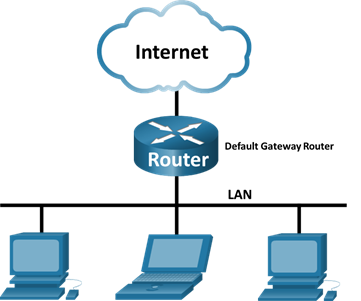
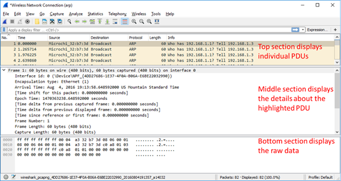
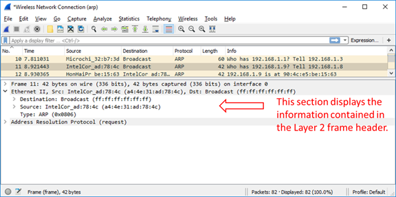
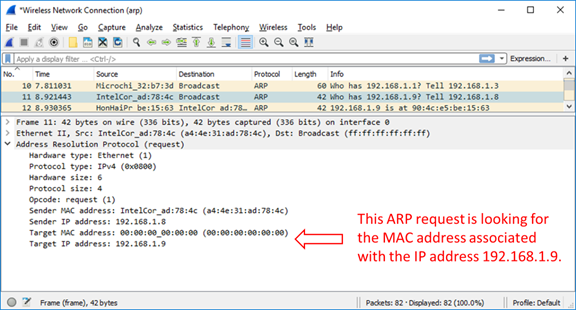

# D03-01: Преглед на прихванат мрежов трафик във Wireshark

> **Поток:** напреднали | **Време:** ~45 мин | **Среда:** Windows 10/11, Wireshark 4.6.x с Npcap
> **Задължителен минимум:** Част 1 и Част 2, Стъпка 1. **Разширение:** Част 2, Стъпка 2.
> **Връзка с курса:** лекции D02-02 (Ethernet, MAC адреси) и D01-04 (диагностика, `arp`); упражнение D03-02 (ARP в Packet Tracer) го предхожда; държавни въпроси 11 и 13.

## Топология

<!-- TODO: заменете със снимка от Wireshark 4.6 -->


## Цели на упражнението

### Част 1: Прихващане и анализ на локални ARP данни във Wireshark

- Стартиране и спиране на прихващането на данни от ping трафик до хостове в локалната мрежа
- Намиране на IPv4 и MAC адресна информация в прихванатите PDU
- Анализиране на съдържанието на ARP съобщенията, обменени между устройствата в LAN

### Част 2: Преглед на ARP кеш записите на компютъра

- Достъп до Windows Command Prompt
- Използване на командата `arp` за преглед на локалната ARP таблица в кеша на компютъра

## Теоретична основа / Сценарий

**Address Resolution Protocol (ARP)** се използва от TCP/IP за напасване (map, mapping) на IPv4 адрес от слой 3 към MAC адрес от слой 2. Когато Ethernet frame се изпраща в мрежата, той трябва да има destination MAC адрес. За да открие динамично MAC адреса на известна дестинация, source устройството излъчва (broadcast) ARP request в локалната мрежа. Устройството, което притежава IP адреса, отговаря с ARP reply съобщение (unicast), което съдържа неговия MAC адрес.

Всяко устройство в локалната мрежа поддържа собствен ARP кеш. ARP кешът е малка област в RAM паметта, която съхранява ARP отговорите. Преглеждането на ARP кеша на компютър показва IPv4 адреса и MAC адреса на всяко устройство в локалната мрежа, с което компютърът е обменил ARP съобщения.

**Wireshark** е софтуерен protocol analyzer (пакетен анализатор), или "packet sniffer" приложение, използвано за прихващане (capture) и преглед на данни, пътуващи през мрежата.

Wireshark **декодира пакета до нивото на полетата (fields) в рамката**. Това означава, че той не само прихваща суровите байтове, но и ги разбива на отделните им компоненти. Например при ARP рамка Wireshark показва поотделно MAC адресите (source и destination), типа на протокола, IP адресите и типа на операцията (request/reply).

Wireshark вижда трафика, който достига до мрежовия адаптер на компютъра. В комутирана мрежа това са собственият трафик на компютъра и broadcast/multicast рамките. За да се наблюдава чужд unicast трафик, комутаторът трябва предварително да е настроен да копира трафика към порта на компютъра (port mirroring, SPAN). Самото стартиране на Wireshark не включва тази функция.

Когато данните се изпращат от един хост към друг в мрежата, пакетът е капсулиран с информация за заглавката (header), която включва source и destination MAC адреси. MAC адресът на destination хоста се открива чрез ARP процеса. Чрез изследване на ARP съобщенията в Wireshark можете да наблюдавате този процес и да идентифицирате IP и MAC адресите на хостовете, комуникиращи в локалната мрежа.

## Необходими ресурси

- 1 PC (Windows 10/11) с Wireshark 4.6.x и Npcap
- Права за стартиране на Command Prompt като администратор (за `arp -d`)
- Достъп до Интернет
- Допълнителни компютри в локалната мрежа (LAN), които ще отговарят на ping заявки. Ако няма допълнителни компютри в LAN, ще се използва default gateway адресът за отговор на ping заявките.

> **Важно за филтрите:** Wireshark има два вида филтри. **Capture filter** (на началния екран, преди старта) решава кои пакети изобщо да се запишат и използва друг синтаксис. **Display filter** (лентата над списъка с пакети) само скрива пакети от екрана. В това упражнение стартирайте прихващането **без** capture filter и въвеждайте филтрите в лентата за display filter.

---

## Част 1: Прихващане и анализ на локални ARP данни във Wireshark

В Част 1 на това упражнение ще направите ping на друг компютър в LAN и ще прихванете ARP requests и replies във Wireshark. Ще разгледате и съдържанието на прихванатите рамки. Този анализ трябва да изясни как заглавките на пакетите се използват за транспорт на данните до тяхната дестинация.

### Стъпка 1: Извличане на интерфейсните адреси на вашия компютър

За това упражнение ще трябва да извлечете IPv4 адреса и MAC адреса на вашия компютър.

**a.** Отворете Command Prompt **като администратор** (Start, напишете `cmd`, десен бутон, **Run as administrator**) и въведете командата `ipconfig /all`.

**b.** Отбележете кой мрежов адаптер използва компютърът за достъп до мрежата. Запишете IPv4 адреса и MAC адреса (Physical Address) на интерфейса на вашия компютър.

```
C:\Users\Student>ipconfig /all

<output omitted>

Wireless LAN adapter Wireless Network Connection:
   Connection-specific DNS Suffix  . :
   Description . . . . . . . . . . . : Intel(R) Centrino(R) Advanced-N 6205
   Physical Address. . . . . . . . . : A4-AE-31-AD-78-4C
   DHCP Enabled. . . . . . . . . . . : Yes
   Autoconfiguration Enabled . . . . : Yes
   Link-local IPv6 Address . . . . . : fe80::f9e7:e41d:a772:f993%11(Preferred)
   IPv4 Address. . . . . . . . . . . : 192.168.1.8(Preferred)
   Subnet Mask . . . . . . . . . . . : 255.255.255.0
   Default Gateway . . . . . . . . . : 192.168.1.1
   DHCP Server . . . . . . . . . . . : 192.168.1.1
   DNS Servers . . . . . . . . . . . : 192.168.1.1
```

**c.** Попитайте колега за IPv4 адреса на неговия компютър и му дайте вашия IPv4 адрес. Не давайте вашия MAC адрес в този момент.

Запишете в Notepad IPv4 адресите на default gateway и на другите компютри в LAN.

**d.** Изчистете ARP кеша, за да сте сигурни, че ще има нов ARP обмен. Ако адресът на шлюза вече е в кеша, компютърът няма да изпрати ARP request и Wireshark няма да покаже ARP рамки.

```
C:\Windows\System32>arp -d
```

> **Забележка:** Без администраторски права Windows отказва изтриването със съобщение, че операцията изисква повишени права (elevation).

> **Предвидете:** Преди да стартирате прихващането, запишете какъв ще бъде destination MAC адресът на ARP request и какъв ще бъде destination MAC адресът на ARP reply.

### Стъпка 2: Стартиране на Wireshark и започване на прихващането на данни

**a.** На вашия компютър кликнете **Start** и напишете **Wireshark**. Стартирайте приложението.

**b.** На началния екран изберете мрежовия интерфейс, който идентифицирахте с командата `ipconfig` (обикновено **Ethernet** или **Wi-Fi**; активният интерфейс има графика на трафика до името си). Не въвеждайте нищо в полето за capture filter. Кликнете **Start capturing packets** (синята икона с перка на акула).

**c.** В лентата за display filter (**Apply a display filter**) над списъка с пакети въведете `arp` и натиснете Enter. Полето трябва да стане зелено. Сега Wireshark показва само пакетите от ARP обмена.

Всеки ред в горната секция представлява съобщение, изпратено между source и destination устройство в мрежата.

**d.** В Command Prompt направете ping на default gateway, за да тествате свързаността към адреса, идентифициран в Част 1, Стъпка 1.

```
C:\Windows\System32>ping 192.168.1.1

Pinging 192.168.1.1 with 32 bytes of data:
Reply from 192.168.1.1: bytes=32 time=7ms TTL=64
Reply from 192.168.1.1: bytes=32 time=2ms TTL=64
Reply from 192.168.1.1: bytes=32 time=1ms TTL=64
Reply from 192.168.1.1: bytes=32 time=6ms TTL=64

Ping statistics for 192.168.1.1:
    Packets: Sent = 4, Received = 4, Lost = 0 (0% loss),
Approximate round trip times in milli-seconds:
    Minimum = 1ms, Maximum = 7ms, Average = 4ms
```

**e.** Направете ping на IPv4 адресите на други компютри в LAN, които са ви дали вашите колеги.

> **Забележка:** Ако компютърът на вашия колега не отговаря на ping, това може да се дължи на firewall, който блокира тези заявки. Помолете преподавателя за помощ при необходимост.

**f.** Спрете прихващането на данни, като кликнете **Stop capturing packets** (червения квадрат) в лентата с инструменти.

### Стъпка 3: Изследване на прихванатите данни

В Стъпка 3 ще изследвате данните, генерирани от ping заявките. Wireshark показва данните в три секции:

1. **Горната секция (Packet List)** показва списъка на прихванатите рамки с резюме за всяка от тях.
2. **Средната секция (Packet Details)** показва избраната рамка, разделена по нейните протоколни слоеве.
3. **Долната секция (Packet Bytes)** показва суровите данни на рамката в шестнадесетичен (hex) вид и като ASCII символи.

**a.** Кликнете на една от ARP рамките в горната секция, която има MAC адреса на вашия компютър като source адрес и "Broadcast" като destination.

**b.** С избрана рамка преминете към средната секция. Кликнете на стрелката вляво от реда **Ethernet II**, за да видите Destination и Source MAC адресите.

_Съвпада ли Source MAC адресът с адреса на интерфейса на вашия компютър?_

<!-- TODO: заменете със снимка от Wireshark 4.6 -->


**c.** Кликнете на стрелката вляво от реда **Address Resolution Protocol (request)**, за да видите съдържанието на ARP request.

_Каква е стойността на полето Type в Ethernet II заглавката?_

### Стъпка 4: Намиране на ARP reply рамката, която съответства на маркирания ARP request

**a.** Използвайки **Target IP address** в ARP request, намерете ARP reply рамката в горната секция.

_Какъв е IPv4 адресът на Target устройството във вашия ARP request?_

**b.** Маркирайте reply рамката в горната секция. Може да се наложи да превъртите списъка. Разгънете редовете **Ethernet II** и **Address Resolution Protocol (reply)** в средната секция.

_Broadcast рамка ли е ARP reply?_

_Какъв е destination MAC адресът на рамката?_

_Съвпада ли той с MAC адреса на вашия компютър?_

_Какъв е source MAC адресът на рамката?_

<!-- TODO: заменете със снимка от Wireshark 4.6 -->


**c.** Проверете с вашия колега дали MAC адресът съвпада с MAC адреса на неговия компютър.

<details markdown="1">
<summary>Отговори за самопроверка</summary>

- Type в Ethernet II заглавката на ARP рамка е **0x0806**.
- ARP request е broadcast (`ff:ff:ff:ff:ff:ff`), а ARP reply е **unicast**: destination е MAC адресът на вашия компютър, а source е MAC адресът на устройството, притежаващо търсения IP адрес.

</details>

---

## Част 2: Изследване на ARP кеш записите на компютъра

Когато устройствата изпращат трафик в локалната мрежа, те трябва да напаснат IP адресите към MAC адреси. За да намалят броя на ARP broadcasts, компютрите кешират ARP отговорите в паметта за кратък период от време.

### Стъпка 1: Преглед на ARP кеша на вашия компютър

**a.** В Command Prompt въведете `arp -a` и натиснете Enter.

```
C:\Windows\System32>arp -a

Interface: 192.168.1.8 --- 0xb
  Internet Address      Physical Address      Type
  192.168.1.1           c0-3f-0e-b7-ce-30     dynamic
  192.168.1.11          08-3e-8e-ba-e4-f9     dynamic
  192.168.1.255         ff-ff-ff-ff-ff-ff     static
  224.0.0.22            01-00-5e-00-00-16     static
  224.0.0.251           01-00-5e-00-00-fb     static
  224.0.0.252           01-00-5e-00-00-fc     static
  239.255.255.250       01-00-5e-7f-ff-fa     static
  255.255.255.255       ff-ff-ff-ff-ff-ff     static
```

_Появяват ли се в ARP таблицата всички устройства, на които направихте ping? Ако не, защо?_

<!-- TODO: заменете със снимка от Wireshark 4.6 -->


### Стъпка 2 (разширение): Изследване на ARP процеса, когато кеш записът изчезне

**a.** Във Wireshark кликнете **Start capturing packets**, за да започнете ново прихващане. Изберете **Continue without Saving**, ако бъдете попитани. Display filter `arp` остава.

**b.** В Command Prompt (като администратор) въведете `arp -d` и натиснете Enter. Това изтрива всички записи в ARP кеша.

```
C:\Windows\System32>arp -d
```

**c.** Направете ping на default gateway или на друг компютър в мрежата.

**d.** Спрете прихващането във Wireshark. Ще видите нови ARP request и reply съобщения.

**e.** Въведете отново `arp -a`. Сега ще видите запис за устройството, на което току-що направихте ping.

---

## Въпроси за размисъл

**1.** Каква е ползата от запазването на ARP кеш записите в паметта на source компютъра?

<details markdown="1">
<summary>Отговор</summary>

Запазването на ARP кеш записи намалява броя на ARP broadcast съобщенията в мрежата. Когато хост трябва да изпрати данни към друг хост, той първо проверява своя ARP кеш за съответстващ MAC адрес и чак тогава изпраща ARP request. Това ускорява комуникацията и намалява мрежовия трафик.

</details>

**2.** Ако destination IPv4 адресът не е в същата мрежа като source хоста, какъв MAC адрес ще се използва като destination MAC адрес в рамката?

<details markdown="1">
<summary>Отговор</summary>

Ако destination IPv4 адресът е в друга мрежа, source хостът използва MAC адреса на default gateway (маршрутизатора) като destination MAC адрес в Ethernet рамката. Затова в ARP request той търси IP адреса на шлюза, а не IP адреса на крайната дестинация. Маршрутизаторът препраща пакета към правилната мрежа.

</details>

## Обяснете сами (без готов отговор)

1. Защо преди прихващането изчистихме ARP кеша?
2. Кое поле в прихванатите рамки доказва, че ARP reply е изпратен само до вашия компютър?
3. Какво ще видите във Wireshark, ако направите ping до адрес в същата мрежа, който не е зает от никое устройство?

---

## Заключение

В това упражнение използвахме Wireshark за прихващане и анализ на ARP трафик в локалната мрежа. Видяхме как ARP напасва IP адресите към MAC адреси и как компютрите кешират тази информация за по-ефективна комуникация. Wireshark е мощен инструмент за детайлен анализ на мрежовите протоколи и разбиране на техните механизми.

<script data-goatcounter="https://satanasov.goatcounter.com/count"
        async src="//gc.zgo.at/count.js"></script>

<script src="/SNA/assets/js/analytics-logger.js"></script>
