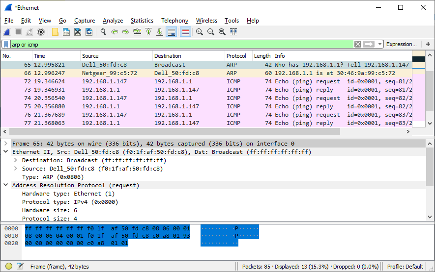
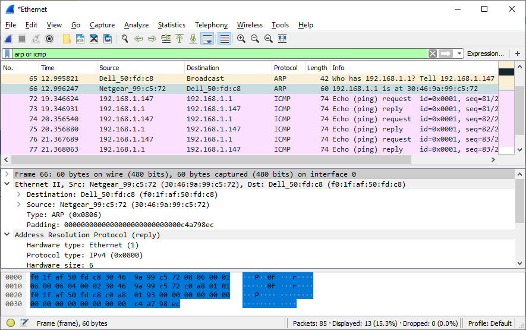
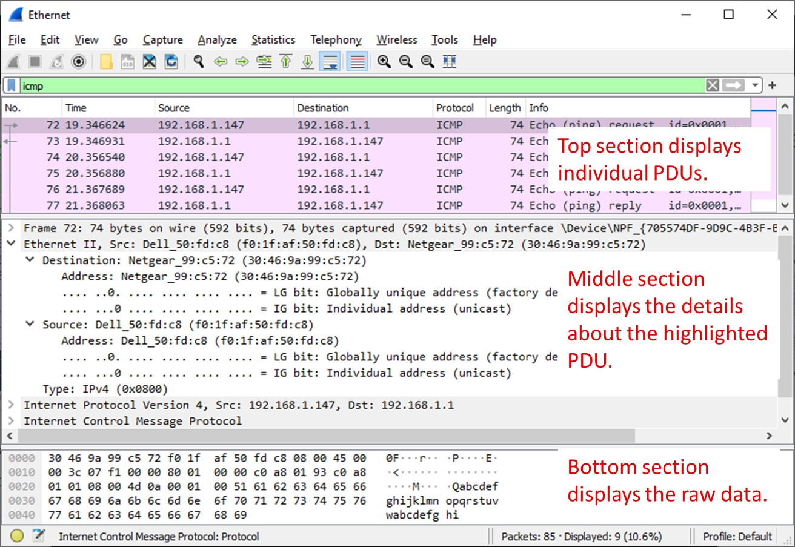

# D03-03: Използване на Wireshark за изследване на Ethernet рамки (frames)

> **Поток:** напреднали | **Време:** ~45 мин | **Среда:** Windows 10/11, Wireshark 4.6.x с Npcap
> **Задължителен минимум:** Част 1 и Част 2, Стъпки 1–6. **Разширение:** Част 2, Стъпка 7.
> **Връзка с курса:** лекции D02-02 (Ethernet рамка, MAC адреси, OUI) и D01-02 (капсулиране, PDU); държавни въпроси 11 и 13.

## Цели на упражнението

### Част 1: Изследване на заглавните полета в Ethernet II рамка

- Преглед на описанията и дължините на полетата в Ethernet II header
- Изследване на мрежовата конфигурация на компютъра
- Изследване на Ethernet рамки в прихванат трафик
- Изследване на съдържанието на Ethernet II header в ARP request

### Част 2: Използване на Wireshark за прихващане и анализ на Ethernet рамки

- Определяне на IP адреса на default gateway
- Стартиране на прихващане на трафик на мрежовия адаптер (NIC)
- Филтриране в Wireshark за показване само на ICMP трафик
- Ping към default gateway
- Спиране на прихващането
- Изследване на Echo (ping) request рамки
- Прихващане на пакети към отдалечен хост

## Теоретична основа / Сценарий

Когато протоколите от горните слоеве комуникират помежду си, данните преминават надолу през слоевете на OSI или TCP/IP модела и се капсулират в Layer 2 рамка, когато достигнат data link слоя. Структурата на рамката зависи от типа на средата, през която данните се предават. Например рамките, които пътуват през Ethernet, се различават от рамките, които пътуват през WLAN или серийна връзка.

Ethernet II рамката е типичната структура, използвана в TCP/IP мрежите. Wireshark декодира и показва полетата на рамката от Destination MAC адреса до данните. Preamble, SFD и обикновено FCS не присъстват в прихващането, защото мрежовият адаптер ги обработва и премахва, преди да предаде рамката на операционната система.

В това упражнение ще разгледате заглавните полета и съдържанието на Ethernet II рамка. Ще използвате Wireshark за прихващане и изследване на Ethernet II рамки към локални и отдалечени хостове.

## Необходими ресурси

- 1 PC (Windows 10/11) с достъп до Интернет
- Wireshark 4.6.x с Npcap, инсталиран на компютъра

> **Важно за филтрите:** Стартирайте прихващането **без** capture filter (полето на началния екран остава празно). Филтрите в това упражнение (`arp or icmp`, `icmp`) се въвеждат в лентата за display filter над списъка с пакети.

---

## Част 1: Изследване на заглавните полета в Ethernet II рамка

В Част 1 ще изследвате заглавните полета и съдържанието на Ethernet II рамка, като използвате готово прихващане.

### Стъпка 1: Преглед на описанията и дължините на полетата в Ethernet II header

Ethernet II рамката се състои от следните полета:

| Поле | Дължина | Описание |
|------|---------|----------|
| Preamble | 7 байта | Използва се за синхронизация между изпращащото и получаващото устройство |
| Start Frame Delimiter (SFD) | 1 байт | Сигнализира началото на рамката |
| Destination MAC Address | 6 байта | MAC адресът на устройството получател |
| Source MAC Address | 6 байта | MAC адресът на устройството изпращач |
| Type / Length | 2 байта | Стойност ≥ 0x0600 е **Type** и идентифицира протокола в полето Data (0x0800 = IPv4, 0x0806 = ARP, 0x86DD = IPv6). Стойност ≤ 1500 е **Length** (рамка IEEE 802.3) |
| Data | 46–1500 байта | Съдържа данните (Layer 3 PDU); при по-малко от 46 байта се допълва (padding) |
| Frame Check Sequence (FCS) | 4 байта | Използва се за откриване на грешки в рамката |

> **Забележка:** Wireshark не показва Preamble и SFD, защото тези полета се обработват на хардуерно ниво от мрежовия адаптер. По същата причина в прихващане под Windows обикновено липсва и FCS: адаптерът я проверява и премахва.

### Стъпка 2: Изследване на мрежовата конфигурация на компютъра

В този пример компютърът има IP адрес 192.168.1.147 и default gateway с IP адрес 192.168.1.1. (За Linux използвайте `ip addr`, а за macOS – `ifconfig` в терминала.)

```
C:\>ipconfig /all

Ethernet adapter Ethernet:

   Connection-specific DNS Suffix  . :
   Description . . . . . . . . . . . : Intel(R) 82579LM Gigabit Network Connection
   Physical Address. . . . . . . . . : F0-1F-AF-50-FD-C8
   DHCP Enabled. . . . . . . . . . . : Yes
   Autoconfiguration Enabled . . . . : Yes
   Link-local IPv6 Address . . . . . : fe80::58c5:45f2:7e5e:29c2%11(Preferred)
   IPv4 Address. . . . . . . . . . . : 192.168.1.147(Preferred)
   Subnet Mask . . . . . . . . . . . : 255.255.255.0
   Default Gateway . . . . . . . . . : 192.168.1.1
   DHCP Server . . . . . . . . . . . : 192.168.1.1
   <output omitted>
```

### Стъпка 3: Изследване на Ethernet рамки в прихванат трафик

Следващите снимки показват пакетите, генерирани от ping, изпратен от компютъра до неговия default gateway. Приложен е display filter `arp or icmp`, за да се виждат само ARP и ICMP. ARP (Address Resolution Protocol) се използва за определяне на MAC адреса, свързан с даден IP адрес. Сесията започва с ARP request и reply за MAC адреса на шлюза, последвани от четири ping requests и replies.

<!-- TODO: заменете със снимка от Wireshark 4.6 -->


Тази снимка подчертава детайлите на рамката за ARP request.

<!-- TODO: заменете със снимка от Wireshark 4.6 -->


Тази снимка подчертава детайлите на рамката за ARP reply.

### Стъпка 4: Изследване на съдържанието на Ethernet II header в ARP request

Следващата таблица взема първата рамка в прихващането и показва данните в полетата на Ethernet II header:

| Поле | Стойност |
|------|----------|
| Destination MAC Address | ff:ff:ff:ff:ff:ff (Broadcast) |
| Source MAC Address | f0:1f:af:50:fd:c8 (Wireshark го показва като Dell_50:fd:c8) |
| Type | 0x0806 (ARP) |

#### Въпроси:

**1.** Какво е значимо в съдържанието на полето destination address?

**2.** Защо компютърът изпраща broadcast ARP преди първия ping request?

**3.** Какъв е source MAC адресът в първата рамка?

**4.** Какъв е Vendor ID (OUI) на source NIC в ARP request?

**5.** Коя част от MAC адреса е OUI?

**6.** Каква е частта от MAC адреса, присвоена от производителя на конкретния адаптер?

<details markdown="1">
<summary>Отговори за самопроверка</summary>

1. Destination адресът е `ff:ff:ff:ff:ff:ff`, т.е. broadcast. ARP request се изпраща до всички устройства в локалната мрежа.
2. Компютърът трябва да научи MAC адреса на default gateway, за да изпрати ping пакета. Тъй като първоначално не го знае, той пита с broadcast: „Кой има IP адрес 192.168.1.1?“.
3. `F0:1F:AF:50:FD:C8` – MAC адресът на мрежовия адаптер на компютъра.
4. OUI е `F0:1F:AF`. Той е регистриран на **Dell**. Затова Wireshark показва адреса като `Dell_50:fd:c8`. Описанието „Intel 82579LM“ в `ipconfig` е моделът на чипа, а адресът е присвоен от производителя на компютъра.
5. Първите 3 октета (байта) на MAC адреса.
6. Последните 3 октета, `50:FD:C8`. Това е идентификатор на конкретния адаптер, присвоен от производителя (NIC-specific part).

</details>

---

## Част 2: Използване на Wireshark за прихващане и анализ на Ethernet рамки

В Част 2 ще използвате Wireshark за прихващане на локални и отдалечени Ethernet рамки. След това ще изследвате информацията в заглавните полета на рамката.

### Стъпка 1: Определяне на IP адреса на default gateway на вашия компютър

**a.** Отворете Windows Command Prompt.

**b.** Въведете командата `ipconfig`. (За Linux използвайте `ip route`, а за macOS – `netstat -rn`.)

**c.** Запишете IP адреса на default gateway на компютъра.

```
C:\>ipconfig

Ethernet adapter Ethernet:

   Connection-specific DNS Suffix  . :
   Link-local IPv6 Address . . . . . : fe80::58c5:45f2:7e5e:29c2%11
   IPv4 Address. . . . . . . . . . . : 192.168.1.147
   Subnet Mask . . . . . . . . . . . : 255.255.255.0
   Default Gateway . . . . . . . . . : 192.168.1.1
```

_Какъв е IP адресът на default gateway на вашия компютър?_

**d.** Затворете прозореца на Command Prompt.

### Стъпка 2: Стартиране на прихващане на трафик на NIC на компютъра

**a.** Отворете Wireshark. Оставете полето за capture filter празно и кликнете двукратно на интерфейса с мрежов трафик, за да стартирате прихващането.

**b.** Наблюдавайте трафика, който се появява в списъка с пакети.

### Стъпка 3: Филтриране в Wireshark за показване само на ICMP трафик

Display filter не спира записването на нежелани данни; той само определя какво се показва на екрана. За сега ще се показва само ICMP трафик.

В лентата за display filter напишете `icmp`. Полето трябва да стане зелено, ако филтърът е въведен правилно. Натиснете Enter или кликнете стрелката вдясно на лентата, за да приложите филтъра.

### Стъпка 4: Ping към default gateway на вашия компютър

**a.** Отворете Windows Command Prompt.

**b.** Направете ping на default gateway, използвайки IP адреса, който записахте в Стъпка 1.

```
C:\>ping 192.168.1.1

Pinging 192.168.1.1 with 32 bytes of data:
Reply from 192.168.1.1: bytes=32 time<1ms TTL=64
Reply from 192.168.1.1: bytes=32 time<1ms TTL=64
Reply from 192.168.1.1: bytes=32 time<1ms TTL=64
Reply from 192.168.1.1: bytes=32 time<1ms TTL=64

Ping statistics for 192.168.1.1:
    Packets: Sent = 4, Received = 4, Lost = 0 (0% loss),
Approximate round trip times in milli-seconds:
    Minimum = 0ms, Maximum = 0ms, Average = 0ms
```

**c.** Затворете прозореца на Command Prompt.

### Стъпка 5: Спиране на прихващането на трафик

Кликнете иконата **Stop capturing packets** (червения квадрат), за да спрете прихващането.

### Стъпка 6: Изследване на първия Echo (ping) request във Wireshark

Главният прозорец на Wireshark е разделен на три секции: **Packet List** (горе), **Packet Details** (в средата) и **Packet Bytes** (долу). Ако сте избрали правилния интерфейс, Wireshark показва ICMP пакетите в Packet List.

<!-- TODO: заменете със снимка от Wireshark 4.6 -->


**a.** В Packet List кликнете на първата рамка в списъка. В колоната Info трябва да видите **Echo (ping) request**. Редът трябва да бъде подсветен.

**b.** Изследвайте първия ред в Packet Details. Този ред показва дължината на рамката.

_Каква е дължината на рамката?_

**c.** Вторият ред в Packet Details показва, че това е Ethernet II рамка. Показани са и source и destination MAC адресите.

_Какъв е MAC адресът на NIC на компютъра?_

_Какъв е MAC адресът на default gateway?_

**d.** Кликнете стрелката (>) в началото на втория ред, за да видите повече информация за Ethernet II рамката.

_Каква е стойността на полето Type и какъв протокол означава?_

**e.** Последните два реда в средната секция съдържат информация за полето Data на рамката: заглавките на IPv4 и ICMP. Забележете, че данните съдържат source и destination IPv4 адресите.

_Какъв е source IP адресът?_

_Какъв е destination IP адресът?_

**f.** Можете да кликнете на всеки ред в средната секция, за да подсветите съответната част от рамката (hex и ASCII) в Packet Bytes. Кликнете на реда **Internet Control Message Protocol** и изследвайте какво е подсветено.

_Какво изписват последните два подсветени октета?_

**g.** Кликнете на следващата рамка в горната секция и изследвайте Echo reply рамката. Забележете, че source и destination MAC адресите са разменени, тъй като тази рамка е изпратена от default gateway като отговор на първия ping.

_Кое устройство и кой MAC адрес се показват като destination адрес?_

<details markdown="1">
<summary>Отговори за самопроверка</summary>

- **d.** Type е `0x0800`, т.е. IPv4.
- **f.** При Windows данните на ping са `abcdefghijklmnopqrstuvwabcdefghi` (32 байта), затова последните два октета изписват **hi**.
- **g.** Destination е вашият компютър и неговият MAC адрес.

</details>

### Стъпка 7 (разширение): Прихващане на пакети към отдалечен хост

> **Предвидете:** Преди да изпълните стъпката, запишете кои от четирите адреса (source/destination MAC, source/destination IP) ще бъдат същите като в Стъпка 6 и кои ще се променят.

**a.** Кликнете иконата **Start capturing packets**, за да стартирате ново прихващане. Ще се появи прозорец с въпрос дали да запазите предишните пакети във файл. Кликнете **Continue without Saving**.

**b.** В Command Prompt направете ping на www.cisco.com. Адресът, който ще получите, може да е различен от примера.

```
C:\>ping www.cisco.com

Pinging e144.dscb.akamaiedge.net [23.222.28.109] with 32 bytes of data:
Reply from 23.222.28.109: bytes=32 time=30ms TTL=56
Reply from 23.222.28.109: bytes=32 time=29ms TTL=56
Reply from 23.222.28.109: bytes=32 time=30ms TTL=56
Reply from 23.222.28.109: bytes=32 time=29ms TTL=56

Ping statistics for 23.222.28.109:
    Packets: Sent = 4, Received = 4, Lost = 0 (0% loss),
Approximate round trip times in milli-seconds:
    Minimum = 29ms, Maximum = 30ms, Average = 29ms
```

**c.** Спрете прихващането.

**d.** Изследвайте новите данни в Packet List.

_В първата Echo (ping) request рамка какви са source и destination MAC адресите?_

- Source: ______
- Destination: ______

_Какви са source и destination IP адресите в полето Data на рамката?_

- Source: ______
- Destination: ______

Сравнете тези адреси с адресите от Стъпка 6. Единственият адрес, който се е променил, е destination IP адресът. _Защо destination IP адресът се е променил, докато destination MAC адресът е останал същият?_

<details markdown="1">
<summary>Отговор</summary>

Когато ping се изпраща към отдалечен хост (извън локалната мрежа), destination MAC адресът е MAC адресът на default gateway, защото рамката трябва първо да стигне до шлюза. Destination IP адресът е адресът на крайната дестинация (www.cisco.com). При обикновена маршрутизация IP адресите не се променят по пътя, а MAC адресите се сменят на всяка мрежа. Ако локалната мрежа използва частни адреси, маршрутизаторът на изхода към Интернет допълнително подменя **source** IP адреса чрез NAT; това не се вижда в прихващането на вашия компютър.

</details>

---

## Въпроси за размисъл

Wireshark не показва полето Preamble на frame header. Какво съдържа Preamble?

<details markdown="1">
<summary>Отговор</summary>

Preamble съдържа 7 байта с редуваща се последователност от единици и нули (`10101010`), която позволява на получаващото устройство да синхронизира часовника си с изпращащото. Следва SFD (`10101011`), който отбелязва началото на рамката. И двете полета се обработват на хардуерно ниво и не се виждат в софтуерни анализатори като Wireshark.

</details>

## Обяснете сами (без готов отговор)

1. Защо в Echo reply source и destination MAC адресите са разменени спрямо Echo request?
2. Как Wireshark „знае“, че в полето Data на рамката има IPv4 пакет, а не ARP съобщение?
3. Какъв ще бъде destination MAC адресът, ако в мрежата няма default gateway и направите ping до отдалечен хост?

---

## Заключение

В това упражнение изучихме структурата на Ethernet II рамката и изследвахме полетата в нейната заглавка. Разбрахме ролята на MAC адресите в локалната комуникация и как Ethernet рамките капсулират IP пакети. Видяхме разликата между комуникация с локален хост (в същата мрежа) и с отдалечен хост (извън локалната мрежа): destination MAC адресът сочи към следващия hop (шлюза за отдалечени хостове), а destination IP адресът остава адресът на крайната дестинация.

<script data-goatcounter="https://satanasov.goatcounter.com/count"
        async src="//gc.zgo.at/count.js"></script>

<script src="/SNA/assets/js/analytics-logger.js"></script>
